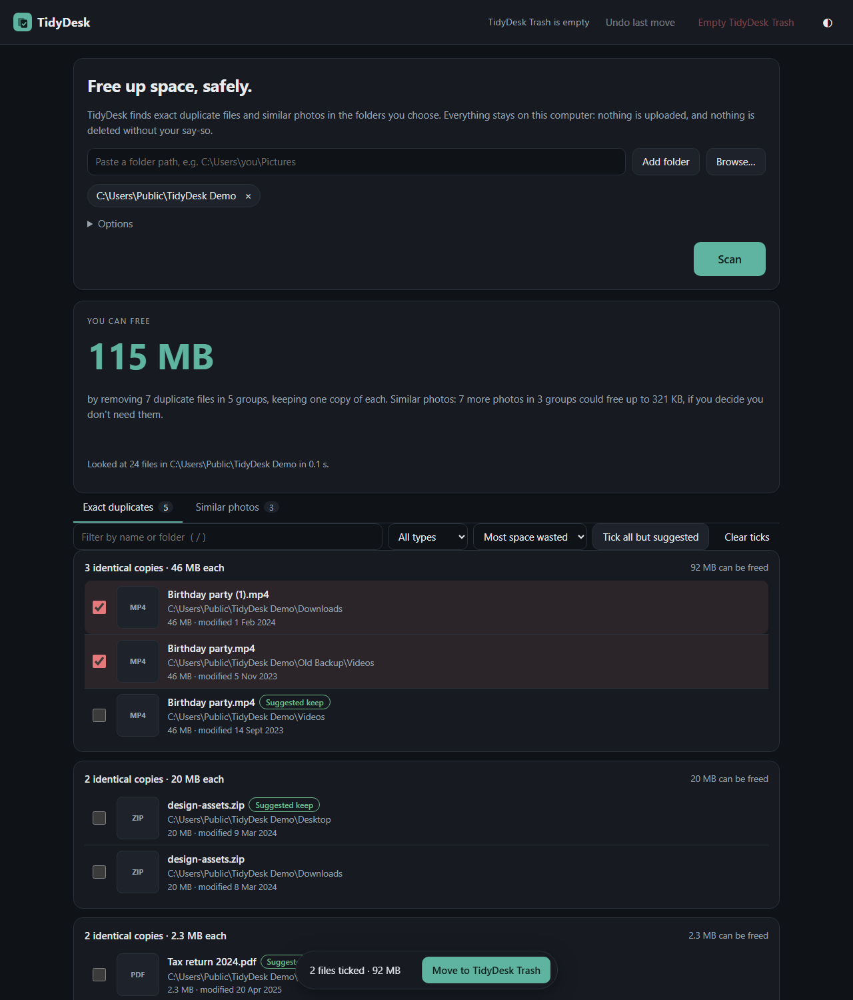
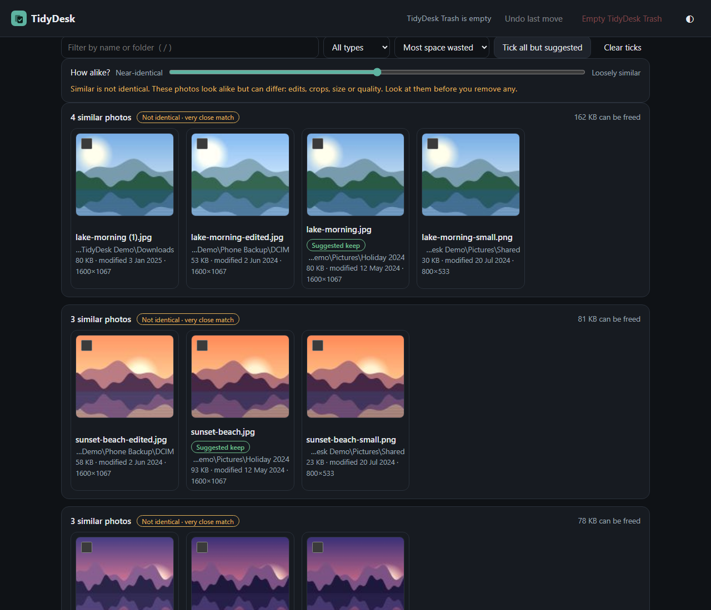
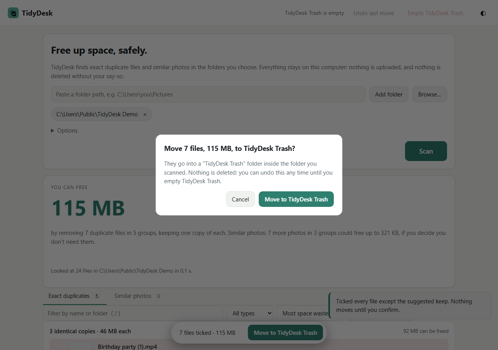
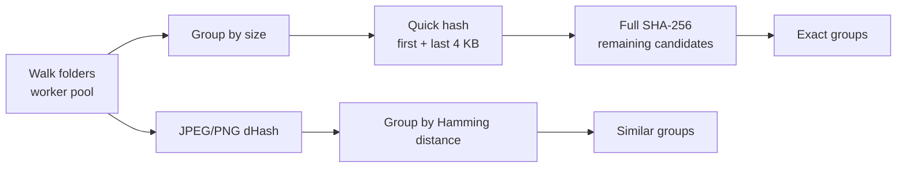

# TidyDesk

Find duplicate files and similar photos on your PC and clean them up safely. TidyDesk is one small executable written in Go. It opens a local page in your browser, and nothing ever leaves your machine.



| Similar photos (clearly marked "not identical") | Confirm before anything moves (light theme) |
|---|---|
|  |  |

*Screenshots of the real app scanning a generated demo folder: drawn landscape images and random-content files, no personal data.*

## What it does

- **Exact duplicates.** Files are grouped by size, then by a quick SHA-256 of the first and last 4 KB, then by a full SHA-256, but only for the files still matching. Files are streamed in 1 MB chunks and never loaded whole.
- **Similar photos.** JPEG and PNG files get a 64-bit perceptual hash (dHash). Photos whose hashes differ by only a few bits are grouped, and a slider sets how close counts as "similar". These groups are clearly labelled *not identical*.
- **Live progress** (server-sent events): files found, data checked, groups found, time left in the current step, and a Cancel button.
- **Options:** minimum file size, file types (all, photos, videos, documents), and folders to skip.
- **Suggestions, not decisions.** Each group marks a suggested file to keep, with the reason (original-looking name and folder, oldest copy, shortest path, or most pixels for photos). Nothing moves until you tick files and confirm.

The folder walk runs concurrently with a bounded worker pool. Symlinks, junctions, system folders (`C:\Windows`, `$Recycle.Bin`, `.git`, …) and unreadable items are skipped. Problems are counted and listed, never fatal. TidyDesk uses only the Go standard library: zero third-party dependencies.



## Run it

**[Download tidydesk.exe](https://github.com/Omkar210404/Tidy-Desk/releases/latest/download/tidydesk.exe)** (Windows, 7.6 MB) and double-click it. Windows may show a SmartScreen warning because the exe is not code-signed: click "More info", then "Run anyway". Or build it yourself with Go 1.22 or newer:

```
git clone https://github.com/Omkar210404/Tidy-Desk
cd Tidy-Desk
build.cmd            :: makes dist\tidydesk.exe  (or: go build -o dist/tidydesk.exe .)
dist\tidydesk.exe
```

| Command | What it does |
|---|---|
| `tidydesk` | Starts the app on a free port on 127.0.0.1 and opens your browser |
| `tidydesk --port 8080` / `tidydesk --no-browser` | Use a fixed port, or don't open the browser |
| `tidydesk selftest` | Builds a tiny temporary folder (duplicates, near-duplicate images, unique files, an unreadable file), runs the real scanner and the Remove, Undo and Empty actions on it, prints PASS/FAIL per step, then deletes it |
| `tidydesk bench` | Times a scan of 5,000 generated small files (about 160 MB), then deletes them. Refuses to run with less than 2 GB free |
| `build.cmd all` | Also builds Linux (amd64) and macOS (arm64) binaries |

## How safety works

- **Nothing is deleted directly.** "Move to TidyDesk Trash" moves files into a `TidyDesk Trash` folder inside the folder you scanned. A `manifest.json` there records each file's original path. The manifest is written *before* files move, so a crash can't lose track of one.
- **Undo** puts the last move back exactly where it was, and never overwrites a file that has appeared there since. TidyDesk Trash folders are remembered between runs, so Undo still works after a restart.
- **Empty TidyDesk Trash** is the only way anything is deleted for good, and it needs an explicit confirmation in the UI and on the server.
- **Keep-one rule, enforced by the server.** Any request that would leave a group with no file is refused as a whole. The UI warns you too.
- **Path checks.** Actions use file IDs from the latest scan, not raw paths. Before moving a file, TidyDesk checks that it is inside a folder you chose, is a regular file (not a link), is unchanged since the scan (same size and modified time), and isn't reached through a folder that has turned into a link.
- **Browser isolation.** The server binds to 127.0.0.1 only and checks the `Host` header (against DNS rebinding). Every API call needs a random per-session token, and actions must send it in a header, so other websites open in your browser can't trigger them. The page also refuses to be framed.

## Speed

Measured with `tidydesk bench` on one machine: AMD Ryzen 5 5600H (12 threads), SSD, Windows 11. The dataset was 5,000 generated files totalling 157.5 MB, just written, so mostly in the OS file cache (a warm-cache result):

| Scan | Time | Files/s |
|---|---|---|
| Duplicates only | 0.13 s | ~37,800 |
| Duplicates + similar photos (250 small images) | 0.22 s | ~22,600 |

Real folders on a cold disk, especially a hard drive, will be much slower. Treat these numbers as one data point, not a promise.

## Similar tools

Mature tools like [Czkawka](https://github.com/qarmin/czkawka) and [dupeGuru](https://dupeguru.voltaicideas.net/) already do this, with more features. TidyDesk aims for simplicity: one file, a calm interface, and a safe, exact undo.

## Limitations

- Similar-photo matching covers JPEG and PNG only (other formats are still checked for exact duplicates). There is no video similarity.
- Similar photos are compared all-pairs: instant for thousands of photos, slow for libraries in the hundreds of thousands.
- TidyDesk Trash lives inside each scanned folder, so a file on another drive mounted inside that folder can't be moved; it is reported as skipped.
- Photos above 80 megapixels are skipped for similarity and previews.
- Tested on Windows 11 only. The Linux and macOS code compiles but hasn't been run. The native "Browse…" picker uses PowerShell on Windows, `osascript` on macOS and `zenity` on Linux; typing a path always works.

## License

MIT
